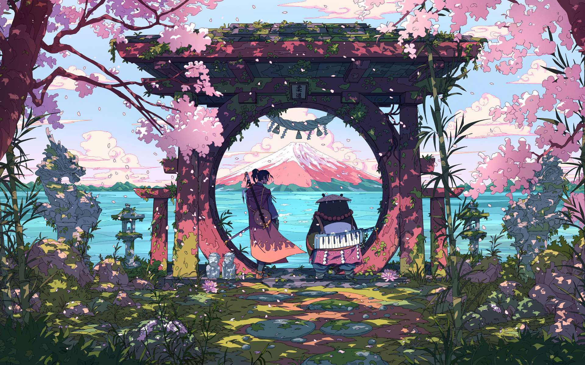

<samp>

**DaKsH** // dev // learning // building


<a href="https://x.com/JavariaDaksh"><strong>x</strong></a> | <a href="https://www.linkedin.com/in/daksh-javaria-20970b336/"><strong>linkedin</strong></a> | <a href="mailto:dakshjavaria2@gmail.com"><strong>email</strong></a>

</samp>

```
lang   js · ts · python · c/c++ · bash
web    next.js · react · node · express · mongodb · postgresql
env    fedora · nvim · zsh · git
other  powerbi · postman
```

<samp>

**selected work**

**[vinoa](https://github.com/daksh8138/vinoa)** — turns images into ascii art on an infinite, pannable canvas. export as png or svg. next.js · react · typescript · tailwind. [live](https://vinoa.vercel.app/) 

</samp>
